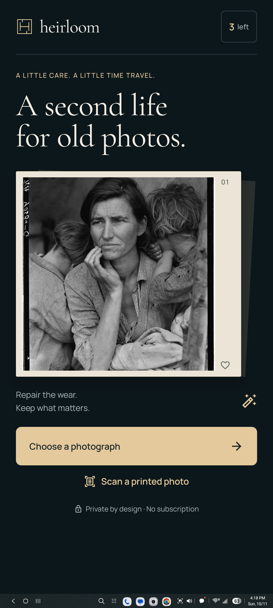
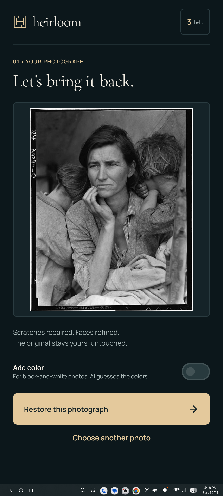
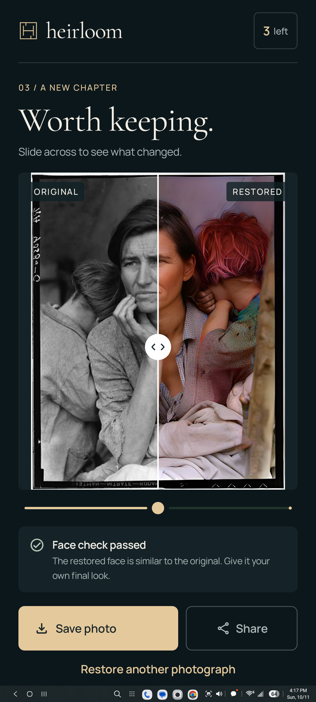
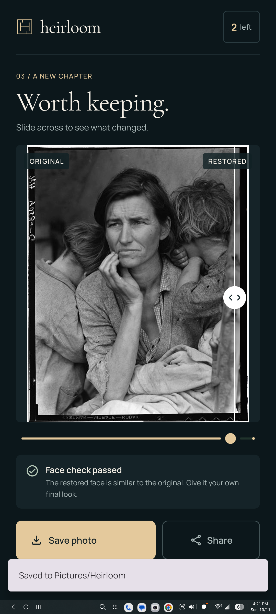
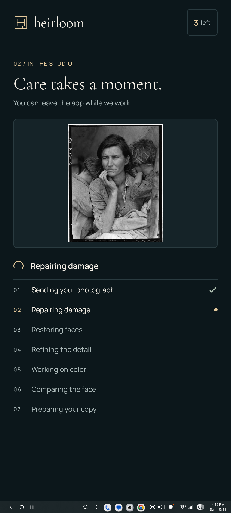
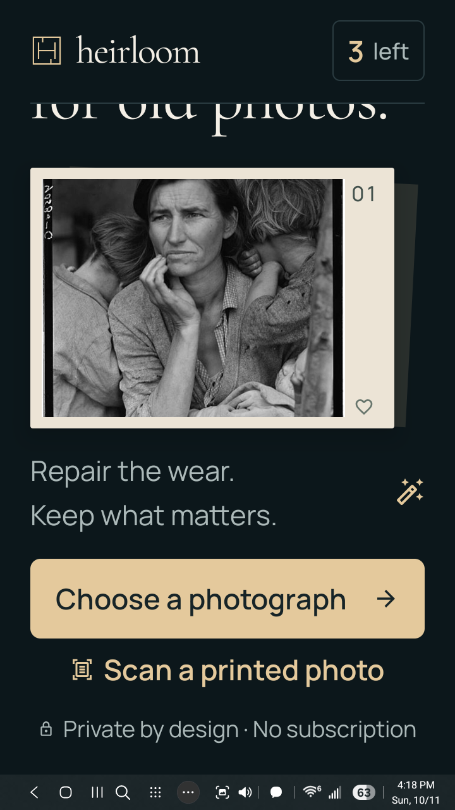

# Heirloom gallery design

A deep ink background, warm paper, a quiet monogram, bundled Cormorant Garamond and Manrope type, and large photographs replace the old empty card. Gallery selection, scanning, restoration, comparison, credits, and error recovery use one shared design.

These are real Android screenshots. The comparison uses the actual image returned by the engine. The smaller screen uses 150 percent text size and scrolls to keep the actions reachable.

## Home

## Selected photograph

## Comparison

## Real restore and save

## Progress

## Large text on a small screen

